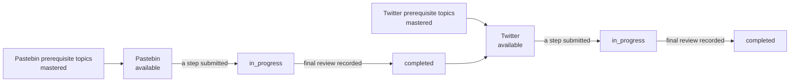

# Design Exercises

The [[Design Exercise]]s the app ships, how they sit at the end of the [[Learning Path]], and how each one is judged against its [[Reference Solution]]. The steps themselves, feedback, [[Hint]]s and the final review are in [[Interview Protocol Implementation]].

## The catalogue

Data in `src/main/protocol/designExercises.ts` (`DESIGN_EXERCISES`). The order index is the exercise index of the [[Interview Protocol]] unlock plan: it decides the active [[Protocol Step]]s.

| # | Slug | Title (UI) | Reference Solution | Active steps |
|---|---|---|---|---|
| 1 | `pastebin` | Design Pastebin.com (or Bit.ly) | primer `pastebin` | functional requirements, high-level design |
| 2 | `twitter` | Design the Twitter timeline and search | primer `twitter` | + estimations |
| 3 | `query_cache` | Design a key-value cache for recent web server queries | primer `query_cache` | + API, data model (5 steps) |
| 4 | `web_crawler` | Design a web crawler | primer `web_crawler` | + non-functional requirements (6 steps) |
| 5 | `social_graph` | Design the data structures of a social network | primer `social_graph` | + deep dive (the full protocol, 7 steps) |
| 6 | `sales_rank` | Design Amazon's sales rank by category | primer `sales_rank` | the 7 steps |
| 7 | `mint` | Design Mint.com | primer `mint` | the 7 steps |
| 8 | `scaling_aws` | Design a system that scales to millions of users on AWS | primer `scaling_aws` | the 7 steps |

All eight primer solutions are in the catalogue (exercises 3 to 8: #46 to #51). The UI title is the primer's title, shortened when it is long ("Design a key-value cache to save the results of the most recent web server queries", "Design the data structures for a social network", "Design Amazon's sales rank by category feature"). A catalogue slot that is not in `DESIGN_EXERCISES` would still show as "coming soon" on the path; there is none left.

- The slug is the Reference Solution id, so `design_exercises.slug`, the path key `design_exercise:<slug>` and `reference_solution_section` all match.
- **Seeding**: `seedDesignExercises` runs at startup (`src/main/index.ts`, after the topics). It inserts the missing exercises only (`position` = order index, `grounded` = true) and never updates an existing row, so a learner's exercise keeps its id, submissions and Hints. It refuses an exercise whose Reference Solution is not in the [[Source Corpus]]. No migration: the columns exist since migration 4.
- **Exercise index**: `exerciseIndexOf` returns the order index of a catalogued exercise. Dev fixtures (`dev-protocol-<n>`, from the "Design exercise (dev)" screen) are separate rows, dev only, and never rank on the path.

## Problem statements (curated)

> [!important] The one deliberate exception to "all content is generated"
> Problem statements are written by hand, in French and in English, and stored in the catalogue (`problemStatements: { fr, en }`). They are not generated and not copied from the primer. The one shown follows the [[Generation Language]] setting.

Why: the primer's "Step 1: Outline use cases and constraints" **is** the reference answer of the functional requirements and estimations steps. Copying it, or letting a Generation paraphrase it, would hand the learner the answer. A statement says only:

- the product being designed and its context (what kind of service, a similar product);
- what to do first (scope, then estimate when estimations are active).

Never: a use case beyond the product's identity, an out-of-scope item, a constraint, a number. Two to four sentences, addressed directly ("tu" in French, "you" in English), system design jargon in English (timeline). Exercises 3 to 8 follow the same rule and name the steps still to do (scope, estimate, API and data model, architecture, and from exercise 4 the non-functional requirements, from exercise 5 the bottlenecks). They say what is being designed and nothing more: no "search" for the crawler (the primer scopes it), no "past week" or "hourly" for the sales rank, no "budget" or "account" for Mint.

| Exercise | Language | Statement |
|---|---|---|
| Pastebin | French | Tu conçois un service web de partage de texte comme Pastebin.com : on y dépose du texte (du code, des logs, une note) pour le partager avec d'autres personnes grâce à un lien. Bit.ly, qui raccourcit des URL, est un problème très proche. Avant de dessiner quoi que ce soit, cadre ce que le service doit faire, et ce qu'il ne fera pas. |
| Pastebin | English | You are designing a web service for sharing text, like Pastebin.com: people drop in some text (code, logs, a note) and share it with others through a link. Bit.ly, which shortens URLs, is a very close problem. Before drawing anything, frame what the service must do, and what it will not do. |
| Twitter | French | Tu conçois le cœur d'un réseau social comme Twitter : chacun y publie des messages courts et suit d'autres personnes pour lire ce qu'elles publient. On te demande la partie timeline et la recherche. Aucun chiffre de trafic n'est donné : pose tes propres hypothèses, estime les ordres de grandeur, puis dessine. |
| Twitter | English | You are designing the core of a social network like Twitter: everyone posts short messages and follows other people to read what they post. You are asked for the timeline and the search. No traffic figure is given: make your own assumptions, estimate the orders of magnitude, then draw. |
| Query cache | French | Tu conçois le cache d'un moteur de recherche web : il garde à portée de main les résultats des requêtes récentes, pour que le moteur n'ait pas à les recalculer à chaque fois. Aucun chiffre ne t'est donné : cadre le périmètre, pose tes propres hypothèses et estime les ordres de grandeur. Ensuite, définis l'API du cache et son modèle de données, puis dessine l'ensemble. |
| Query cache | English | You are designing the cache of a web search engine: it keeps the results of recent queries close at hand, so the engine does not have to compute them again each time. No figure is given: frame the scope, make your own assumptions and estimate the orders of magnitude. Then define the API of the cache and its data model, and draw the whole thing. |
| Web crawler | French | Tu conçois un robot d'exploration du web (web crawler) : un programme qui parcourt le web de page en page en suivant les liens qu'il y trouve. Ce que le service fait des pages collectées, c'est à toi de le décider. Cadre le périmètre, précise les exigences non fonctionnelles, pose tes hypothèses et estime les ordres de grandeur, puis définis l'API et le modèle de données, et dessine l'architecture. |
| Web crawler | English | You are designing a web crawler: a program that explores the web by going from page to page through the links it finds. What the service does with the pages it collects is for you to decide. Frame the scope, state the non-functional requirements, make your assumptions and estimate the orders of magnitude, then define the API and the data model, and draw the architecture. |
| Social network | French | Tu conçois les structures de données qui se cachent derrière un réseau social, où des personnes sont reliées les unes aux autres. À toi de décider ce que le service fait de ces liens. Cadre le périmètre, précise les exigences non fonctionnelles et estime les ordres de grandeur, puis définis l'API et le modèle de données, dessine l'architecture et cherche ses goulots d'étranglement. |
| Social network | English | You are designing the data structures behind a social network, where people are connected to one another. It is up to you to decide what the service does with these connections. Frame the scope, state the non-functional requirements and estimate the orders of magnitude, then define the API and the data model, draw the architecture and look for its bottlenecks. |
| Sales rank | French | Tu conçois la fonctionnalité de classement des ventes d'un grand site de vente en ligne comme Amazon : les produits y sont classés selon leur succès dans leur catégorie. À toi de décider ce que cette fonctionnalité doit faire, et ce qu'elle laisse de côté. Estime les ordres de grandeur et précise les exigences non fonctionnelles, puis définis l'API et le modèle de données, dessine l'architecture et cherche ses goulots d'étranglement. |
| Sales rank | English | You are designing the sales rank feature of a large online store like Amazon: products are ranked by how well they sell within their category. It is up to you to decide what this feature must do, and what it leaves aside. Estimate the orders of magnitude and state the non-functional requirements, then define the API and the data model, draw the architecture and look for its bottlenecks. |
| Mint | French | Tu conçois Mint.com, un service de gestion de finances personnelles : il aide chacun à mieux maîtriser son argent. À toi de décider ce que le service fait pour ses utilisateurs, et ce qu'il ne fait pas. Estime les ordres de grandeur et précise les exigences non fonctionnelles, puis définis l'API et le modèle de données, dessine l'architecture et cherche ses goulots d'étranglement. |
| Mint | English | You are designing Mint.com, a personal finance service that helps people keep better control of their money. It is up to you to decide what the service does for its users, and what it does not. Estimate the orders of magnitude and state the non-functional requirements, then define the API and the data model, draw the architecture and look for its bottlenecks. |
| Scaling on AWS | French | Tu conçois une application web hébergée sur AWS, le cloud d'Amazon, dont le public doit passer de quelques personnes à une foule immense sans que le service s'effondre. Savoir utiliser AWS n'est pas indispensable : les idées valent partout. Cadre le périmètre, estime les ordres de grandeur et précise les exigences non fonctionnelles, puis définis l'API et le modèle de données, dessine l'architecture et cherche ses goulots d'étranglement. |
| Scaling on AWS | English | You are designing a web application hosted on AWS, Amazon's cloud, whose audience must grow from a handful of people to a very large crowd without the service collapsing. Knowing AWS is not required: the ideas apply anywhere. Frame the scope, estimate the orders of magnitude and state the non-functional requirements, then define the API and the data model, draw the architecture and look for its bottlenecks. |

Guarded by `designExercises.test.ts`, for each exercise and each language: 2 to 4 sentences, direct address ("tu" / "you"), no digit, and no run of 4 or more consecutive words shared with the solution's use cases, constraints or Step 1 (the check is itself tested on a copied sentence). `leakGuard.test.ts` also checks that neither statement nor title matches the exercise's leak guard terms.

**Which statement is shown**: `problemStatementFor(slug, language)` in the language of the setting, read each time an exercise is opened or judged (the exercise view, and the problem statement of the step feedback, Hint and final review prompts). The French statement is also what `seedDesignExercises` stores in `design_exercises.problem_statement`, never updated: it is the fallback of an exercise the catalogue does not know (a dev fixture). Switching the language rewrites nothing, and the feedback already given stays as it was. The leak guard patterns match French and English wordings, and the statements of both languages count as text the learner was given.

## Prerequisites and completion

- **Topics**: `DESIGN_EXERCISE_PREREQUISITES` (`src/main/path/designExercisePrerequisites.ts`, table in [[Learning Path Implementation#Design Exercise prerequisites]]). Pastebin: performance-vs-scalability, load-balancer, database, cache. Twitter: the same plus content-delivery-network, application-layer, asynchronism. **Rule (tested)**: each exercise lists at least the topics of the previous one, so the list only grows along the catalogue: query cache adds latency-vs-throughput, the web crawler adds domain-name-system (the social network and the sales rank add nothing, their own topics were already in), Mint adds security, scaling on AWS adds availability-patterns and reverse-proxy-web-server (12 topics). The catalogue comes first in that list, in order index order.
- **What the solutions rely on, checked on the six new ones (#46 to #51)**: the Step 3 components of each solution are covered by the topics (cache for the query cache, queues and NoSQL for the crawler, services and sharding for the social network, MapReduce and SQL for the sales rank, queues and SQL for Mint, every tier for scaling on AWS). The crawler's rationale said "duplicate detection with a cache", which the solution does not do (it uses page signatures in a NoSQL store, and MapReduce for duplicate URLs); the cache and the DNS lookup are Step 4 (deep dive) points, now said so. Every Step 4 of the primer ends its topic list with consistency patterns, availability patterns, horizontal scaling and the reverse proxy, and "Service has high availability" is a use case of all eight solutions, yet only scaling on AWS asks for availability-patterns and reverse-proxy-web-server: left as the plan says, noted as an open question.
- **Previous exercise (decision)**: an exercise also needs the previous one **completed** (`previousDesignExercise`). Exercise 2 is designed to add one step to what exercise 1 practised; opening it first would skip the two base steps and their [[Protocol Step Lesson]]s.
- **Opening one anyway**: a [[Forced Unlock]] ("Unlock anyway" on the Learning Path) opens a locked exercise without credit. Its [[Protocol Step]]s unlock by exercise index, so every step active at its position can be played at once, and the steps it skips (the earlier exercise, the prerequisite topics) stay not done. A [[Declared Mastery]] of a prerequisite topic counts as mastered here.
- **Statuses** (`buildLearningPath`): `coming_soon` when not in the catalogue; `completed` once a final review is recorded (it stays completed, even if the learner submits again); `in_progress` once any step was submitted (even if that submission failed); else `locked` while a prerequisite topic is not mastered or the previous exercise is not completed, `available` otherwise. A started exercise is never locked again.
- **Recommended step**: the first open topic first (unchanged), else the first exercise `available` or `in_progress`.
- **Lock enforcement**: outside dev builds, every Interview Protocol entry of a `locked` or `coming_soon` exercise is refused in the main process (`createExerciseLockGuard`, see [[Learning Path Implementation#Lock enforcement]]).

## Reference Solution in the prompts

The prompts no longer receive the whole solution. `referenceForSteps(solution, steps)` (`src/main/protocol/reference.ts`) keeps the parts that answer the steps being judged, under a header that names them:

| Protocol Step | Parts of the primer solution |
|---|---|
| Functional requirements | Use cases (in and out of scope) |
| Non-functional requirements, Estimations | Constraints and assumptions with the back-of-the-envelope usage, plus a note: the learner was given no number, judge the method and orders of magnitude from their own assumptions |
| API, Data model | Step 3, core components |
| High-level design | Step 2 (text only, the diagram is not bundled) and Step 3 |
| Deep dive | Step 4 (scale) and the additional talking points |

- Step feedback and Hints get the parts of the earlier active steps and of the current step; the final review gets the parts of every active step.
- So in exercise 1 no prompt holds the scale numbers or Step 4: the learner is not judged on estimations or scaling, which are not active. In exercise 2 the estimations step is judged against the twitter solution's "Calculate usage" (100 thousand reads/s, 6,000 tweets/s...).
- Every Design Feedback prompt also names the exercise's active steps and says the others are never asked for (`ExerciseBrief.activeSteps`).

**Checked on exercises 3 to 8** (#46 to #51; `designExercises.test.ts` for every catalogued exercise: each active step has a part, and no prompt of the exercise holds Step 4 or the talking points unless the deep dive is active, nor the constraints unless estimations or non-functional requirements are). The sections exist in all eight solutions. What the solutions show about the mapping:

| Exercise | Steps | What the reference gives them |
|---|---|---|
| `query_cache` | + API, data model | Step 3 has no endpoint and no table: the API is the cache's `get`/`set` (and `process_query` of the Query API), the data model a hash table plus a doubly linked list (LRU order). The sharded cache cluster is Step 4, so the high-level design is judged without it. |
| `web_crawler` | + non-functional requirements | Step 3 gives the `links_to_crawl` and `crawled_links` tables in a NoSQL store, page signatures against cycles, MapReduce for duplicate URLs and a `GET /api/v1/search` endpoint. DNS lookup, connection pooling and the cache are Step 4. |
| `social_graph` | + deep dive | Step 3 has `Person` (id, name, friend ids), the Lookup Service and Person Servers and `GET /api/v1/friend_search`; no table. Step 4: Memory Cache, bidirectional BFS, sharding by location. |
| `sales_rank` | the 7 steps | Step 3 has the `sales_rank` table, a log line format and `GET /api/v1/popular`. Step 4 brings a data warehouse and SQL scaling. |
| `mint` | the 7 steps | Step 3 has the `accounts`, `transactions` and `monthly_spending` tables and a POST endpoint. Step 4 adds a use case of its own ("user accesses summaries and transactions"). |
| `scaling_aws` | the 7 steps | Step 3 is a single box (web server and MySQL on one machine, Elastic IP, DNS, closed ports): **no API and no data model at all**. The whole design is Step 4, iterated as Users+, Users++, Users+++... |

Three gaps in the mapping, not changed here:

- **API and data model against `scaling_aws`**: both steps receive Step 3, which has nothing to compare an API or a schema with. The reviewer can only judge them on their own coherence and the earlier steps.
- **Constraints in exercise 3**: estimations and non-functional requirements share the `constraints` part, so the estimations feedback of exercise 3 (no non-functional step yet) also holds the qualitative assumptions (fast lookups, low latency between machines, limited memory, popular queries kept), 4 of the 6 assumptions of the query cache's constraints. The note under the part only speaks about numbers. Splitting the part into assumptions (non-functional requirements) and back-of-the-envelope usage (estimations) would fix it.
- **High-level design in exercises 3 and 4**: Step 2 is an image (not bundled), so the high-level design is compared with Step 3 only; what Step 4 adds (sharding, DNS cache, replicas) is by plan the deep dive's job.

## Verification of exercises 3 to 8 (#46 to #51, 2026-10-16)

- Tests: `designExercises.test.ts` (per exercise and language: statement rules and no run of 4 words shared with the solution; the catalogue, order indexes and active steps; the superset rule of the prerequisites; the Reference Solution parts per active step; seeding of the eight rows), `leakGuard.test.ts` (terms for all eight, none matched by a title or a statement), `service.test.ts` (every catalogued exercise played step by step to the final review in English: hint, each active step, final review, statement and output language in every prompt, Step 4 only with the deep dive), `pathIpc.test.ts` (each exercise locked by the previous one until it is completed, then `available`), `forcedUnlock.test.ts`, `pathText.test.ts`.
- Packaged build (`electron-builder --mac dir`, so locks are enforced), scratch `--user-data-dir`, language-aware fake CLI (no real Generation), driven over the Chrome DevTools protocol (117 checks): each of the six exercises `Locked` on the path, opened with "Unlock anyway" (the first through the confirmation, the others through the path IPC), the French statement shown, the right number of active steps (5, 6, 7, 7, 7, 7), the first Hint, every active step submitted with its feedback (canvas steps with two components from the palette), the final review, the exercise `Completed` and the next one still `Locked`; then the Generation Language set to English: the English statement shown and the new step feedback prompt carrying it, with English output asked. After a restart nothing is seeded again and the statuses are kept. The feedback text is the fake CLI's canned text, so this checks the plumbing, not what a model would say about these solutions.
- **Not done**: no real Generation. What the model gets wrong against each reference, and whether the new leak guard terms catch real paraphrases, stay unchecked for exercises 3 to 8 (the 2026-10-09 review above covers exercises 1 and 2 only).

## Quality review

Sample: [[samples/design-exercises|Sample Design Exercises feedback]], made by `node scripts/design-exercises-check.ts` (4 real calls, sonnet, effort low, 2026-10-09): per exercise, the step feedback of a mediocre functional requirements submission, then the first Hint (level 1).

- **French**: natural, "tu", short sentences, jargon kept in English (timeline, analytics). Minor inconsistency: "hors périmètre" and "hors-périmètre".
- **No verbatim leak**: no sentence, table or number from the reference.
- **Scope**: the exercise 2 feedback says a scale wish belongs to the estimations step ("sera chiffrée à l'étape des estimations"); exercise 1 asks for no number.
- **Hints level 1**: open questions, no component or answer. The Pastebin one points at what happens to a paste over time, close to the reference's expiration item, but as a question.
- **Leak by paraphrase, version 3**: the step feedback named reference items: Pastebin 6 of 10 curated items (accounts, editing, custom link, anonymous, expiration...), Twitter 9 of 11 (home vs user timeline, the out-of-scope list, notifications, high availability...), giving most of the reference's Step 1 away.
- **Version 4 and the leak guard** (6 more real calls, see [[Interview Protocol Implementation#Leak guard]]): the category-only prompt brought the first output to 4/10 and 2/11, 3/11; the guard's retry brought every stored feedback to 0. The feedback now says "tu ne dis pas ce qui est hors périmètre", "pense aux cas limites", "qui d'autre que l'utilisateur agit sur le système ?", and still confirms the learner's own items and flags off-scope additions (likes, retweets).
- **Still leaking**: paraphrases outside the term lists. The Pastebin v4 feedback asks whether data is "gardées toujours" and whether the service does "un travail de fond", which points at expiration and its cleanup job. The guard covers only the first step; Hints, the Twitter estimations numbers and the final review are not checked.

## Related

- [[Design Exercise]], [[Reference Solution]], [[Learning Path]], [[Interview Protocol]], [[Protocol Step]]
- [[Interview Protocol Implementation]], [[Learning Path Implementation]], [[Data Model]], [[Corpus]]
