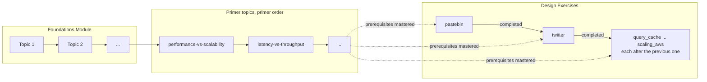

# Learning Path Implementation

How the app computes and shows the [[Learning Path]]: [[Foundations Module]] topics, then the primer [[Topic]]s, then the [[Design Exercise]]s. A step unlocks when the previous topic is mastered ([[Mastery Threshold]] met in a [[Round]] of the [[Mastery Loop]]). The path is the home screen of the app.

## Model

The path is **never stored**: it is computed from the database every time (topics, their mastery from the [[Mastery Loop Implementation|Mastery Loop]] read models, their rounds). Pure code in `src/main/path/model.ts` (`buildLearningPath`), types in `src/shared/learningPath.ts`.

Order:

1. Foundations Module topics (`topics.in_foundations_module`), by position. Zero or more.
2. The teachable primer topics, in primer order (the [[Source Corpus]] topics minus `NON_TEACHABLE_CORPUS_TOPIC_IDS`, see [[Corpus#Teachable topics]]).
3. One Design Exercise slot per primer [[Reference Solution]], in the order of `DESIGN_EXERCISE_PREREQUISITES`: the implemented [[Design Exercises]] first, in their order index, then the others.

Topics that are neither (the dev fixture topic of the Quiz dev screen) are left out.

## Rules

| Step status | Topic step | Design Exercise step |
|---|---|---|
| `mastered` | A round of the topic once passed (`rounds.passed`), whatever came after | Not used |
| `locked` | Not the first step, previous topic not `mastered`, no progress of its own | Implemented, not started, a prerequisite not `mastered` or the previous exercise not `completed` |
| `available` | Unlocked, mastery `not_started` (no lesson recorded, no round opened) | Implemented, not started, every prerequisite `mastered` and the previous exercise `completed` |
| `in_progress` | The topic's mastery: a lesson recorded or a round opened (an abandoned one included), not mastered, skipped or at the Round Limit | A step was submitted (any `protocol_step_submissions` row), no final review yet |
| `skipped`, `limit_reached` | Unlocked, the topic's mastery | Not used |
| `completed` | Not used | A final review is recorded (`design_feedback` kind `final_review`); it stays completed |
| `coming_soon` | Not used | Not implemented yet (`IMPLEMENTED_DESIGN_EXERCISES`) |

- **Strict unlock**: only `mastered` unlocks the next step. A `skipped` or `limit_reached` topic keeps the next one locked; the lock message says why ("Master X first. It was skipped: come back to it with another angle.") with a "Go to X" button, and the recommended step points to that topic, so the learner is never stuck.
- **No regression**: once a round passed, the topic stays `mastered` even if a later round failed (possible from the dev Quiz screen).
- **Threshold changes never re-lock**: `rounds.passed` is stored at completion against the threshold of that time ([[Mastery Loop Implementation#State machine]]); the path only reads it.
- **Progress keeps a step open**: a topic that already has progress (lesson read, a round opened or played) is never shown `locked`, for example when Foundations Module topics are inserted before topics already started. "Progress" is exactly mastery other than `not_started`, the same derivation as the topic header and the Dashboard ([[Mastery Loop Implementation#State machine]], #25).
- **Declared Mastery** (#55): a topic the learner declared as already known is `mastered` (the Mastery Loop derives `mastered` for it, [[Mastery Loop Implementation#Declared Mastery]]), so it unlocks the next topic, counts as a Design Exercise prerequisite and in the progress. `TopicStep.topic.declared` is true only when no round passed, and `canUndoDeclaration` says whether "Undo" is still allowed.
- **Design Exercises** need their own prerequisite topics and, for an implemented exercise after the first, the previous one `completed` (`previousExercise`, from `previousDesignExercise`; the lock message says "Complete X first."). A prerequisite or a previous exercise missing from the path never counts. A started exercise is never locked again. An exercise that is not implemented is `coming_soon` and never startable, but still lists its missing prerequisites. Rationale in [[Design Exercises#Prerequisites and completion]].
- **Recommended step** (`nextStepKey`, the "Continue" call to action): the first topic that is neither `mastered` nor `locked` (a skipped or limit_reached topic included), else the first Design Exercise `available` or `in_progress`, else none.
- **Progress**: mastered topics over all topics (percent rounded down, declared topics included), and Design Exercises whose prerequisites are all mastered. A [[Forced Unlock]] changes none of these.

## Forced Unlock

A learner who already knows the basics, or who wants to try an advanced exercise, opens one `locked` step with "Unlock anyway" ([[Forced Unlock]], #54). Without it a locked topic or exercise cannot be opened in a packaged app, since the lock is enforced in the main process.

- **Stored**: table `forced_unlocks`, one row per step key (`topic:<slug>`, `design_exercise:<slug>`), see [[Data Model]]. `getLearningPath` reads them and hands them to `buildLearningPath` (`forcedUnlocks`, still pure).
- **Model**: a `locked` step with a Forced Unlock gets the status it would have unlocked (`available`, since a locked step has no progress) and `forcedUnlock: true`. `lockedBy` (topic) and `missingPrerequisites` and `lockedByExercise` (exercise) stay filled, so the screen can say what was skipped. The flag is false once the rules unlock the step anyway (the previous topic is mastered), and for a step that is not implemented (`coming_soon`). A started step keeps its own status and the flag while the prerequisite is still missing.
- **One step only, no credit**: the next topic stays locked behind a forced one (only `mastered` unlocks); the progress counters are computed from the steps' own mastery, so `masteredTopics`, `percent` and `unlockedExercises` are those of the path without Forced Unlocks; `nextStep` never recommends a forced step that was not started, so the recommended step is unchanged (a started one is recommended as any started step).
- **Enforcement**: the guards (`createTopicLockGuard`, `createExerciseLockGuard`) only refuse `locked` steps, so a forced step passes with no change to them: the rule stays in one place and the renderer only asks for it. Without the unlock a locked step still refuses a Round, a Remediation Lesson and every Protocol Step entry (tests `forcedUnlock.test.ts`, `protocolIpc.test.ts`). Dev builds still bypass the lock.
- **Protocol Steps**: they unlock by exercise index (`activeStepsFor`), not by earlier submissions, so a forced-unlocked exercise exposes every step active at its position at once; a step can be submitted without the earlier ones (test: Twitter, the estimations step, no earlier submission).
- **Lock again**: allowed while the step has no progress (`available`). A step with progress is refused ("already has progress"), as a started step is never locked.

| `window.api` | Channel | Notes |
|---|---|---|
| `forceUnlockStep({ stepKey })` | `path:forceUnlock` | Zod-validated key (`topic:` or `design_exercise:` plus a slug). Refused for an unknown step and for an exercise coming soon; a step that is not locked is left as it is. Returns the recomputed path and pushes `path:changed`. |
| `lockStepAgain({ stepKey })` | `path:lockAgain` | Removes the unlock; refused once the step has progress; a step without a Forced Unlock is left as it is. Returns the path and pushes `path:changed`. |

Screen: on a `locked` topic or exercise, an "Unlock anyway" button under the lock message opens an inline confirmation ("Open X without credit? A, B will stay not mastered. Your progress does not change and the steps after it stay locked. You can lock it again until you start it.", then "Unlock without credit" or "Cancel"; Escape cancels; the focus moves to the confirm button, then to the button that replaces the one pressed). An opened step shows a "Forced unlock" chip, the line "Opened without credit: ... not mastered." and "Lock again" while it has no progress. The topic and exercise screens opened from it need nothing else. Text in `pathText.ts` (tested).

## Design Exercise prerequisites

Data file `src/main/path/designExercisePrerequisites.ts`, checked by a test against the bundled corpus (one entry per Reference Solution, teachable primer topics only). Chosen from what each primer solution relies on.

| Exercise | Prerequisite topics | Rationale |
|---|---|---|
| `pastebin` | performance-vs-scalability, load-balancer, database, cache | A read-heavy store behind web servers: SQL database and its scaling, a cache for hot pastes, load balancing. |
| `twitter` | performance-vs-scalability, content-delivery-network, load-balancer, application-layer, database, cache, asynchronism | Timeline fan-out and search at scale. |
| `query_cache` | performance-vs-scalability, latency-vs-throughput, content-delivery-network, load-balancer, application-layer, database, cache, asynchronism | An in-memory LRU cache, sharded across machines, in front of a search service: caching strategies, latency, load balancing. |
| `web_crawler` | performance-vs-scalability, latency-vs-throughput, domain-name-system, content-delivery-network, load-balancer, application-layer, database, cache, asynchronism | Queues of pages to crawl, a NoSQL store of links and page signatures to avoid cycles, MapReduce for duplicates; DNS lookups and a cache for popular searches matter when scaling. |
| `social_graph` | performance-vs-scalability, latency-vs-throughput, domain-name-system, content-delivery-network, load-balancer, application-layer, database, cache, asynchronism | A person and lookup service over a sharded user graph: services, database sharding, caching, load balancing. |
| `sales_rank` | performance-vs-scalability, latency-vs-throughput, domain-name-system, content-delivery-network, load-balancer, application-layer, database, cache, asynchronism | A batch (MapReduce) job writing a ranking table read through a cache: asynchronous processing, SQL, caching. |
| `mint` | performance-vs-scalability, latency-vs-throughput, domain-name-system, content-delivery-network, load-balancer, application-layer, database, cache, asynchronism, security | Account sync and categorization with queues and workers, and the security of financial data. |
| `scaling_aws` | performance-vs-scalability, latency-vs-throughput, availability-patterns, domain-name-system, content-delivery-network, load-balancer, reverse-proxy-web-server, application-layer, database, cache, asynchronism, security | From one box to millions of users: every building block. |

`IMPLEMENTED_DESIGN_EXERCISES` is the catalogue of `src/main/protocol/designExercises.ts`: all eight exercises (`pastebin`, `twitter` (#15), then #46 to #51 in the order of the table). Each exercise's prerequisites include the previous one's (tested), so the lists grow along the catalogue; the lock message shows what is still missing. Checked against the solutions in [[Design Exercises#Prerequisites and completion]].

## Service and IPC

`src/main/path/pathIpc.ts`: `getLearningPath({ db, corpus })` (topics with `listTopicMasteries`, `everMastered` from the rounds, primer order and Reference Solution titles from the corpus; for each exercise its `design_exercises` row, its id (`designExerciseId`, to open it) and its progress from submissions and final reviews) and `createLearningPathIpc`.

| `window.api` | Channel | Notes |
|---|---|---|
| `getLearningPath()` | `path:get` | `LearningPath`: steps, `nextStepKey`, progress |
| `forceUnlockStep`, `lockStepAgain` | `path:forceUnlock`, `path:lockAgain` | [[#Forced Unlock]] |
| `onLearningPathChanged(listener)` | `path:changed` | The recomputed path, pushed to the sender after `quiz:completeRound`, `mastery:choose`, `mastery:declare`, `mastery:undoDeclaration`, `path:forceUnlock` and `path:lockAgain` (`src/main/ipc/handlers.ts`) |

## Lock enforcement

The renderer only offers unlocked steps, but the main process does not trust it. `createTopicLockGuard({ db, corpus }, { allowLockedTopics })` (`src/main/path/lock.ts`) recomputes the path and throws a `GenerationError` with code `topic_locked` when the topic's step is `locked`, with a user-actionable message ("Cache is locked. Master Load balancer first, then come back from the Learning Path."). `src/main/index.ts` builds one guard with `allowLockedTopics: !app.isPackaged`, the dev flag of the dev screens, and injects it:

| Entry | Guarded | Refusal |
|---|---|---|
| `mastery:startRound` | yes | `error` event with code `topic_locked` on `mastery:event`, shown by the topic screen with its message |
| `mastery:startRemediation` | yes | same |
| `quiz:startRound` (dev Quiz screen, by quiz id) | yes, on the quiz's topic | the invoke rejects |

- Dev builds (`npm run dev`, unpackaged) open any topic, so the dev screens keep working.
- A topic with progress is never `locked` (see [[#Rules]]), so a topic already started is always allowed, even if Foundations Module topics were inserted before it.
- Topics outside the path (the dev fixture topic) are never locked.
- Also guarded: `lesson:start`. A read lesson counts as progress, which unlocks a topic, so without this guard a renderer could unlock a locked topic by opening its lesson first.

Design Exercises (#15): `createExerciseLockGuard({ db, corpus }, { allowLockedExercises: !app.isPackaged })` is passed to `createProtocolIpc` as `assertExerciseUnlocked`. It runs on every entry of an exercise (`protocol:getExercise`, `saveDraft`, `markLessonSeen`, `submitStep`, `requestHint`, `requestFinalReview`) and throws a plain `Error` (the invoke rejects; the protocol screen shows it) for a `locked` or `coming_soon` exercise: "Design the Twitter timeline and search is locked. First complete Design Pastebin.com (or Bit.ly), then come back from the Learning Path." Dev fixtures are outside the path and never locked; a started exercise is never locked. Tests: `pathIpc.test.ts`, `protocolIpc.test.ts` (every entry refused, no Generation started).

Tests: `src/main/mastery/service.test.ts` (mastery IPC: locked topic refused with `topic_locked` for a round and a Remediation Lesson and no Generation started, allowed in a dev build, topic with progress allowed), `src/main/ipc/quiz.test.ts` (`quiz:startRound` asks the guard with the quiz's topic).

## Screens

`src/renderer/src/path/`:

- `LearningPathScreen`: the home screen (its own visible `h1`). A hero progress card (mastered topics of all topics, percent, `role="progressbar"`, counters Mastered, In progress, Retry required = topics at the [[Round Limit]], Locked), a "Current priority" card with the button on the recommended step (short label from its status: Start, Continue, Come back, Choose how to go on; a topic or a Design Exercise), filter tabs, then one section per stage with a counter ("6/6 mastered", "0/8 completed") and an ordered list of steps, a status chip each, the recommended step marked `aria-current="step"`. Locked steps are not buttons and explain what to master (with "Unlock anyway", see [[#Forced Unlock]]); an open topic that is not mastered offers "I already know this" ([[Mastery Loop Implementation#Declared Mastery]]) and a declared one shows a "Declared" chip and "Undo"; Design Exercises show their missing prerequisites (or the exercise to complete) and rationale. An `available`, `in_progress` or `completed` exercise is a button (`canOpenExercise`) that opens the protocol screen (`ProtocolExerciseScreen`, its Back button returns to the path, which reloads on mount). Loaded on mount and on every `path:changed`.
- `PathTopicView`: a topic opened from the path, the Mastery Loop topic screen (`TopicScreen`) with a "Learning Path" back button. When a push shows the topic mastered, it offers the next unlocked step.
- `TopicScreen` remediation step: a failed round with no missed notion (no Remediation Lesson to read) shows "no missed notion was identified" and a retry button that starts the next round, instead of crashing; `firstRemediationIndex` (`src/renderer/src/mastery/masteryText.ts`, tested) returns null for it.
- `pathText.ts`: labels and messages, filters, counters (tested).

### Visual design

Dark "Terminal Architect" look ([[Design System]]). The hero is an elevated card: mastered count in large mono, percentage in emerald, the indigo-to-emerald `.progress` bar, then four mono-caps counters separated by hairlines (each with a small colored dot, the label carries the meaning). The Current priority card sits under it with an indigo left edge, the step title, what is really known about it (Foundations Module or primer topic, notion count when the Notion Outline exists; the rationale for a Design Exercise), its status chip and the one primary button. The filter tabs (All, Foundations, Primer topics, Design exercises) really filter the sections (`aria-pressed`, underline on the active one). Topic rows are hairline cards: a status circle (check, ring with dot, alert, dash, lock; decorative), title, an "Outside the primer" chip when ungrounded and the status chip with its glowing dot (Mastered, In progress, Not started, Round Limit reached, Locked). A locked row shows why ("Master X first.") and a "Go to X" button when X can be opened; a row at the Round Limit or skipped says what to do. The whole card opens the step (stretched button); focus draws the ring around the card. Design Exercises are cards in a 2-column grid (one column under 760px): title, chip (Ready to start, Locked, In progress, Completed, Coming soon), "3 of 4 prerequisites mastered", the lock reason and the rationale. Nothing is invented: every number comes from the Learning Path model.

`src/renderer/src/App.tsx`: renders every screen inside the `AppShell` ([[Design System#App shell]]: header with Curriculum, Dashboard, Settings and About, content container, version footer). The `Screen` union and the active nav item derivation live in `src/renderer/src/shell/navigation.ts`. The nav item "Curriculum" opens the Learning Path (the home screen). In dev builds a collapsed "Developer tools" section under the path lists All topics (the former Learn list, `MasteryView`), Lessons, Quiz, Design canvas, the version and ping, and the Generation panel (styles in `shell/shell.css`). Base styles (focus outline) are in `styles/base.css`.

## Verification (2026-10-09)

- Tests: `src/main/path/model.test.ts` (order, zero foundations, unknown topics, strict unlock after skipped and limit_reached, no regression, threshold independence, progress keeps a step open, recommended step, exercise prerequisites, coming soon, progress), `pathIpc.test.ts` (path from a migrated database with the bundled corpus, skip blocks, threshold change, prerequisites data against the corpus, push on `path:changed`), `src/renderer/src/path/pathText.test.ts`.
- Built app driven over the Chrome DevTools protocol, scratch `--user-data-dir`, `CLAUDE_CLI_PATH` set to a missing file (no Generation can run): fresh database (first Foundations Module topic recommended, the rest locked, 8 exercises coming soon); seeded database (6 foundations and `performance-vs-scalability` mastered, `latency-vs-throughput` skipped after 3 failed rounds): skipped badge, "Come back to Latency vs throughput with another angle", next topic locked with the skipped explanation and "Go to" button; "Come back now with another angle" recorded the choice (remediation step, CLI error shown as expected); an open round played in the UI and passed: the topic screen showed "Next step unlocked: Availability vs consistency" from the push, and the path showed 8 of 21 mastered with the next topic available, without restart.

Design Exercises (#15, 2026-10-09): built app, fake CLI, scratch `--user-data-dir` with the 7 prerequisite topics of Pastebin and Twitter seeded as mastered, driven over the Chrome DevTools protocol (16 checks, one fixed in the driver itself): Pastebin "Not started" and a button, Twitter "Locked" with "Complete Design Pastebin.com (or Bit.ly) first.", the six others "Coming soon"; Pastebin opened from the path as exercise 1 with the curated statement and only functional requirements and high-level design active; both steps played in the UI (lesson, text, two components added from the palette with notes), final review with the Reference Solution button; Back to the path: Pastebin "Completed", Twitter "Not started" and openable; Twitter opened as exercise 2 with estimations active, the estimations step submitted: Twitter "In progress". After a restart: no exercise seeded again, statuses kept.

## Verification of Forced Unlock (2026-10-15, #54)

- Tests: `model.test.ts` (topic, exercise, exercise whose previous exercise is not completed, a started step, coming soon, counters and recommended step unchanged), `forcedUnlock.test.ts` (migrated database: guards refuse then allow, stored and read by a new instance, lock again then refused with progress, validation, a packaged-style exercise guard with the fake CLI: a forced Twitter plays its estimations step), `pathText.test.ts`.
- Packaged build (`electron-builder --mac dir`, so locks are enforced), scratch `--user-data-dir`, fake CLI: "Unlock anyway" on Twitter (confirmation, then "Forced unlock" and "Ready to start", Pastebin still locked, progress still 0 of 21), the exercise opened with its three active steps, the estimations step submitted and reviewed; app restarted: still "Forced unlock" and "In progress", "Lock again" gone. On a topic: Enter on "Unlock anyway", Enter on the confirmation, focus on "Lock again", Enter, back to "Locked" with focus on "Unlock anyway".

## Verification of Design Exercises 3 to 8 (2026-10-16, #46 to #51)

- Tests: `pathIpc.test.ts` (every catalogued exercise after the first is `locked` by the previous one until it is completed, then `available`; the unseeded path lists the whole catalogue as `locked`), `forcedUnlock.test.ts` (the coming soon case injects a smaller implemented list: the catalogue has no slot left), `pathText.test.ts` (the end-of-path text only says "more exercises are coming soon" while a slot is `coming_soon`).
- Packaged build, scratch user data, fake CLI: the six new exercises `Locked` with 8 to 12 missing prerequisites (and Twitter for the first), opened with "Unlock anyway", played to `Completed`; see [[Design Exercises#Verification of exercises 3 to 8 (#46 to #51, 2026-10-16)]].

## Related

- [[Learning Path]], [[Topic]], [[Foundations Module]], [[Design Exercise]], [[Reference Solution]], [[Forced Unlock]], [[Declared Mastery]]
- [[Mastery Loop Implementation]], [[Lesson View]], [[Corpus]]
